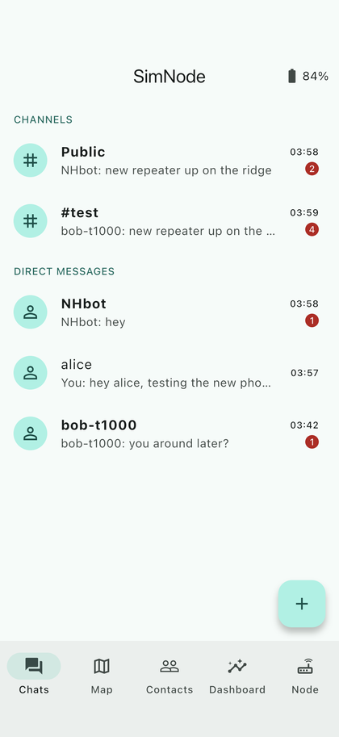
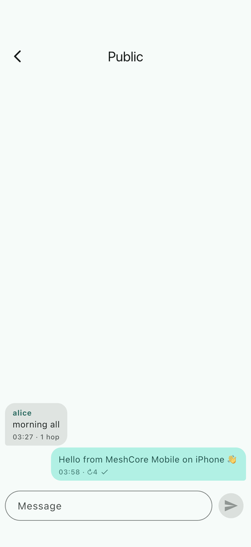
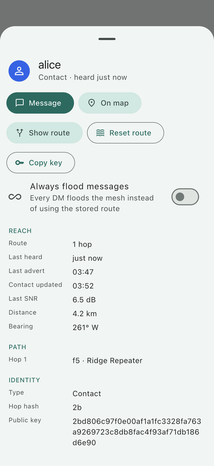
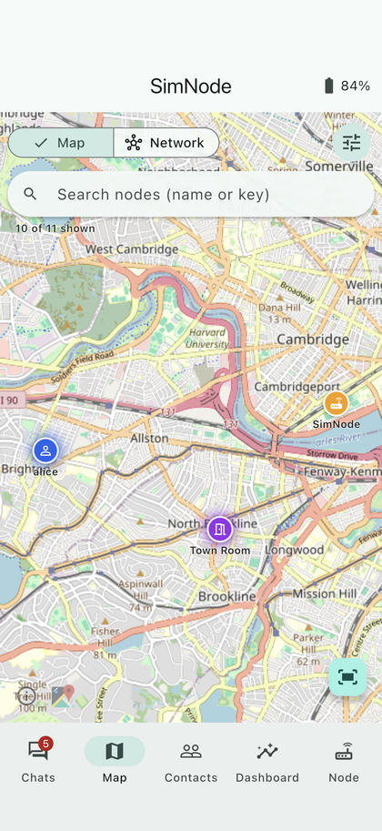
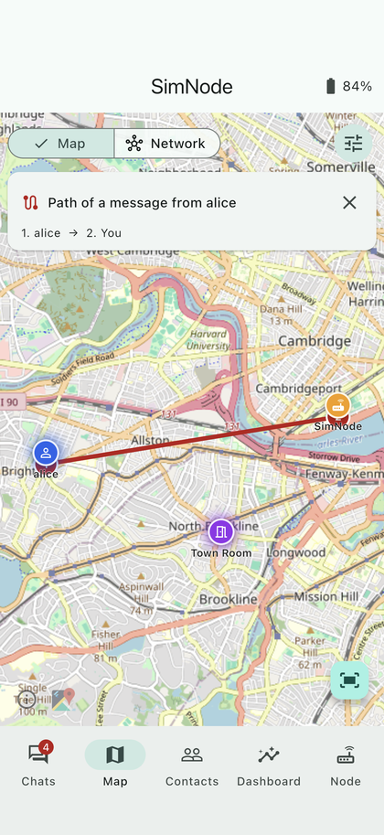
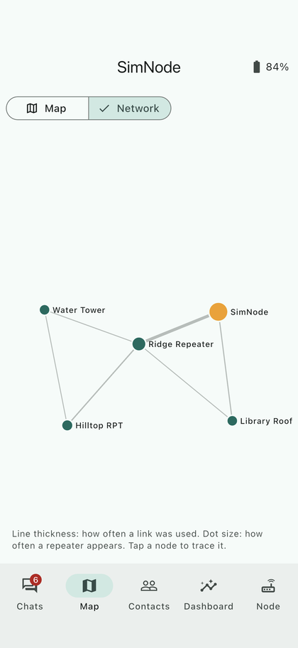
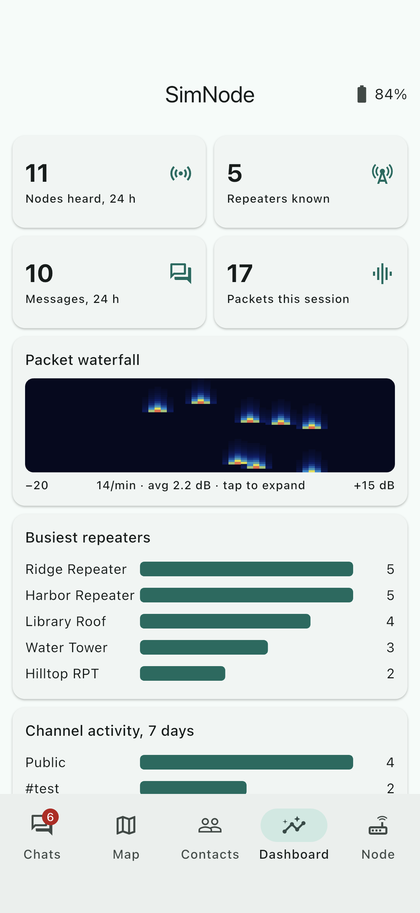
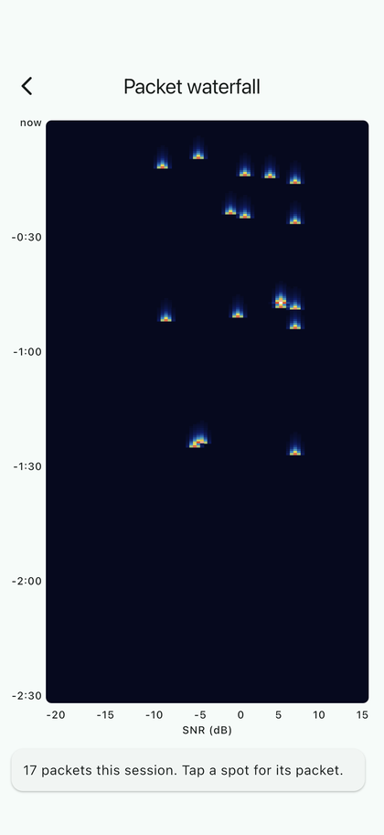
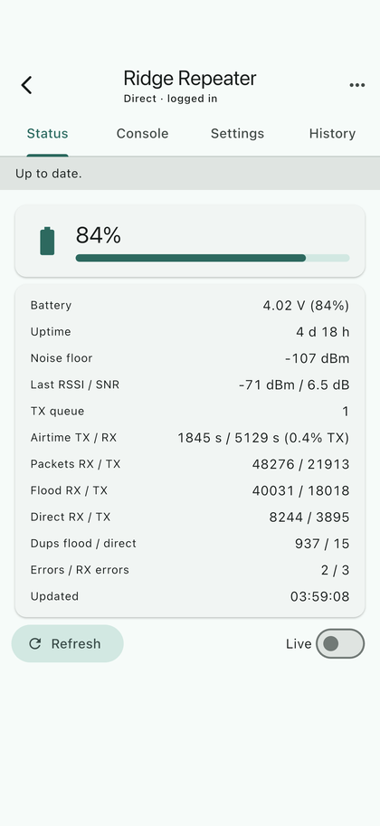
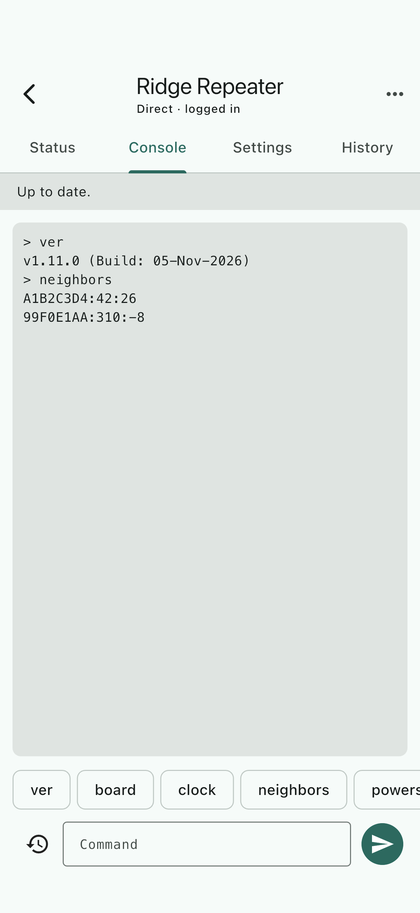

# Full Metal Mesh

A phone chat app for a MeshCore node running companion firmware, over Bluetooth LE. The iPhone and Android
companion to [MeshCore Desktop](https://github.com/Manthany2000/meshcore-desktop), built with Flutter and speaking
the same protocol.

> **v0.3, early.** Works against the built-in simulator; real-node testing in progress.

| Chats | Channel | Contact |
|---|---|---|
|  |  |  |
| **Map** | **Trace a message** | **Relay graph** |
|  |  |  |
| **Dashboard** | **Packet waterfall** | **Repeater status** |
|  |  |  |
| **Repeater console** | | |
|  | | |

<sub>iOS Simulator, running against the built-in pretend node.</sub>

- Channels and direct messages, with unread counts and `@[Name]` mentions highlighted
- Replies: long-press a channel message
- Repeats: how many relayed copies your node heard of each message, which repeaters relayed it, which you heard
  directly and at what SNR, and the path it took (tap a message)
- Delivery status on DMs (✓ on air, ✓✓ delivered with round-trip time, ✗ no ack; long-press → send again)
- **Map**: contacts by type on OpenStreetMap with filters (type, last heard), search and labels; nodes close
  together group into one circle with a count (tap to zoom in); every flood your node hears runs its path across
  the map; show a contact's stored route
- **Trace message**: long-press a received message (or open its details) → *Trace on map* draws the path it took in red
- **Network**: a graph of who relays through whom; tap a node to light up its links
- **Dashboard**: nodes heard, repeaters, messages and packets; busiest repeaters; channel activity; live packets
- **Packet waterfall**, like an SDR's: each packet lands by its SNR and scrolls down; tap it for the big one with
  axes, minutes of history, and tap a spot for its packet
- **Repeater management**: log in, status (battery, uptime, noise, counters) with live refresh, battery/noise/RSSI
  history charts, a console with presets, adverts, reset route. **Settings**: every setting the repeater CLI
  takes, grouped (identity, radio with region presets, repeating, adverts, timing, access), each change checked
  and read back, and an offer to reboot after a radio change; change the admin password. **Regions**: the
  repeater's region tree; add or remove regions, allow or deny floods for each, set the home region and default
  scope, and save (repeater firmware 1.10+)
- **Node setup**: a newly flashed node is spotted on connect (it still has its factory name) and a wizard sets its
  name, radio (the community's region presets), position (tap it on a map), channels, flood scope and Bluetooth
  PIN. A review lists exactly what changes; only that is sent, each step ticked off as the node confirms it
- **Node settings** (Node tab): General, Radio, Privacy (who gets battery, location and sensor readings; extra
  acks), Bluetooth and scope, About; Apply sends only what you changed; restart the node
- **Flood scopes (regions)**: long-press a channel → *Flood scope…* to keep its messages to a region, send them
  unscoped, or use the node's default; set the node's default on the Node tab. The chat header shows the scope.
  Needs firmware with protocol v8 (unscoped sends v12)
- **Notifications** while the app is in the background: DMs, `@[you]` mentions in channels, and new nodes heard;
  tap one to open its chat
- Alerts when a new repeater or contact is heard, and a list of nodes your radio added while the app was closed
- Contacts with type, hops, distance and last heard; full details (route by repeater name, bearing, SNR, key);
  reset route; always flood. A DM's header shows its route by repeater name
- Add `#hashtag` or private channels, remove channels (long-press)
- Zero-hop or flood adverts; sets the node's clock if it's behind
- Messages saved per node on the phone; reconnects by itself when the link drops
- Light and dark themes that follow the phone, with a choice of accent colours (Node tab)
- A simulator (**Try the simulator** on the connect screen) to try it with no radio; the ⋮ beside it also offers
  a freshly flashed node (for the setup wizard) and one that heard someone new while you were away

USB serial isn't available: iPhones don't allow it without Apple's accessory programme.

## Install on an iPhone

Each push to `main` builds an unsigned `.ipa` on GitHub Actions (macOS runner). To put it on your phone:

1. Download **Full-Metal-Mesh-ios** from the latest run on the Actions tab (or the `.ipa` on a release).
2. Sideload it with [Sideloadly](https://sideloadly.io) (Windows/macOS) or AltStore, signing with your Apple ID.
   A free Apple ID's signature lasts 7 days, then re-sideload; a paid developer account lasts a year.
3. On the phone: Settings → General → VPN & Device Management → trust your Apple ID. On iOS 16+, also turn on
   Settings → Privacy & Security → Developer Mode.

The first time you connect, iOS asks for the node's Bluetooth PIN itself.

## Android

The same workflow builds `Full-Metal-Mesh.apk`; install it directly.

## Developing

```
flutter pub get
flutter test                 # protocol vectors shared with MeshCore Desktop, and a full session against the simulator
flutter run -d linux         # desktop window, real BLE through BlueZ
flutter run -d linux --dart-define=SIM=true   # straight into the simulator
flutter run -d linux --dart-define=SIM_FRESH=true   # a freshly flashed simulated node: the setup wizard
SHOTS=/tmp/shots flutter test test/screens_test.dart   # every screen at phone size, light and dark, as PNGs
```

The splash: `lib/src/ui/logo.dart` draws the mark and animates it; the native launch screen before it is
generated from `assets/splash/` with `dart run flutter_native_splash:create`.

Code layout: `lib/src/protocol.dart` (frames), `model.dart` (state, repeats, history), `session.dart` (sync and
commands), `setup.dart` (presets and applying node settings), `transport.dart` (BLE), `sim.dart` (pretend node),
`notify.dart`, `prefs.dart`, `ui/`.

Bluetooth is [flutter_blue_plus](https://pub.dev/packages/flutter_blue_plus), used under its non-commercial licence.
